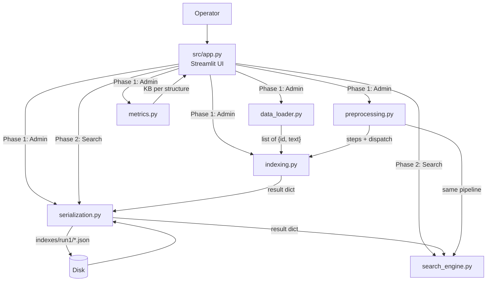
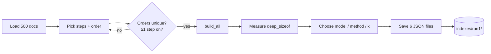
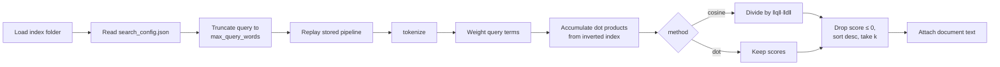
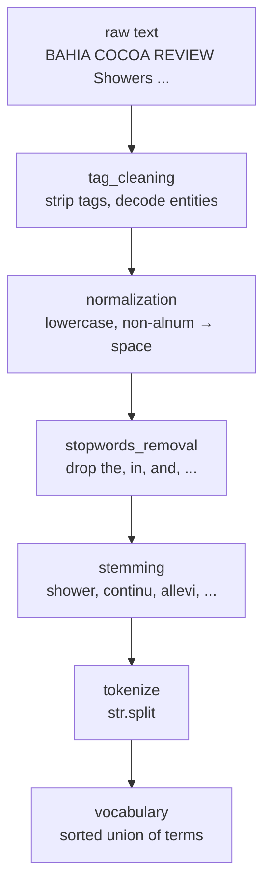
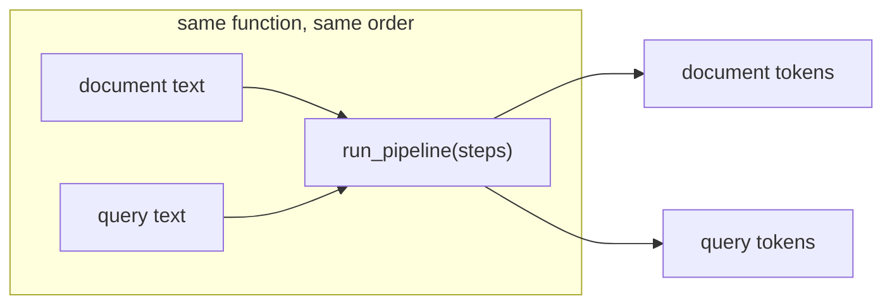
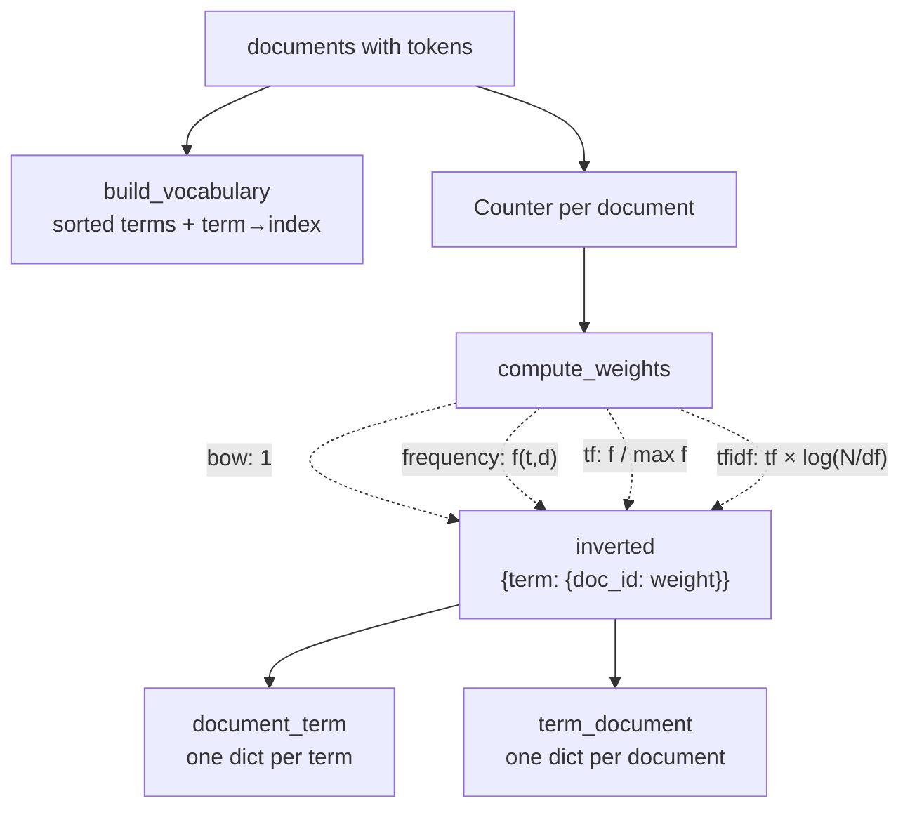
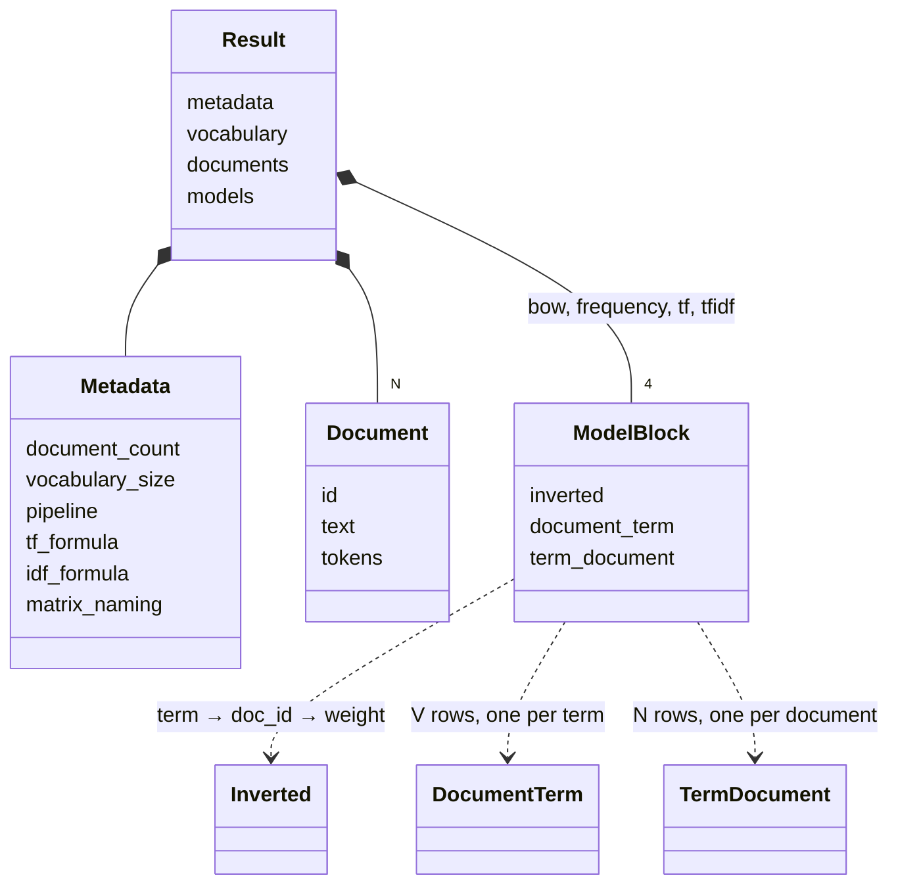
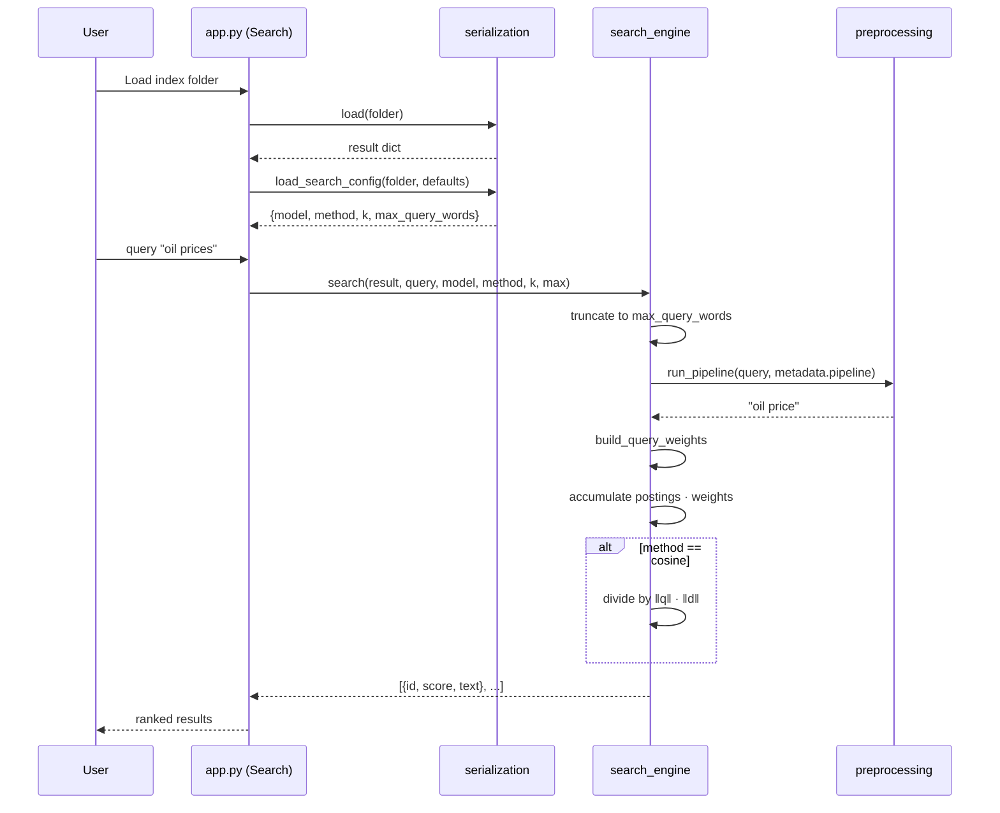
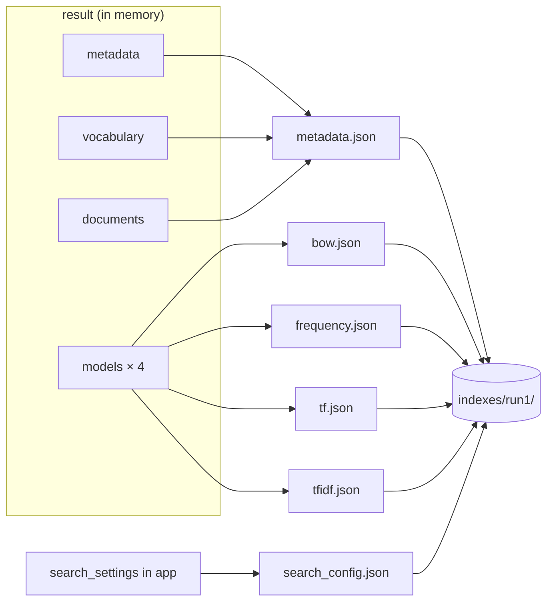
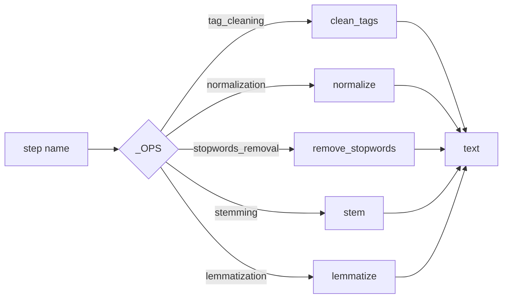

# Diagrams

Mermaid sources. They render on GitHub, GitLab, and in most Markdown previewers.

---

## 1. System architecture



`app.py` is the only stateful component; every other module is a pure function library.

## 2. Phase 1 — Admin indexing flow



## 3. Phase 2 — Guest search flow



## 4. One document through the pipeline



Order is data, not code: the same five operators can be applied in any permutation, and the
permutation is stored in `metadata["pipeline"]` with the index.



## 5. Index construction, per model



All three structures hold exactly the same non-zero values; they differ only in how the
postings are grouped.

## 6. Data model



Sparse representation:

```
inverted["oil"]              = {"D1": 0.405465, "D2": 0.405465}
document_term[oil_index]     = {"D1": 0.405465, "D2": 0.405465}   # rows = terms
term_document[0]             = {"oil": 0.405465, "price": 0.202733, ...}  # rows = docs
```

## 7. Search sequence



## 8. Persistence layout



`load` reads `metadata.json` and all four model files. `load_search_config` tolerates a
missing `search_config.json` and returns the app's defaults.

## 9. Operator dispatch



`run_pipeline` is a fold: `text = _OPS[name](text)` for each name in order. An unknown name
raises `KeyError`; the UI is what keeps names valid.
